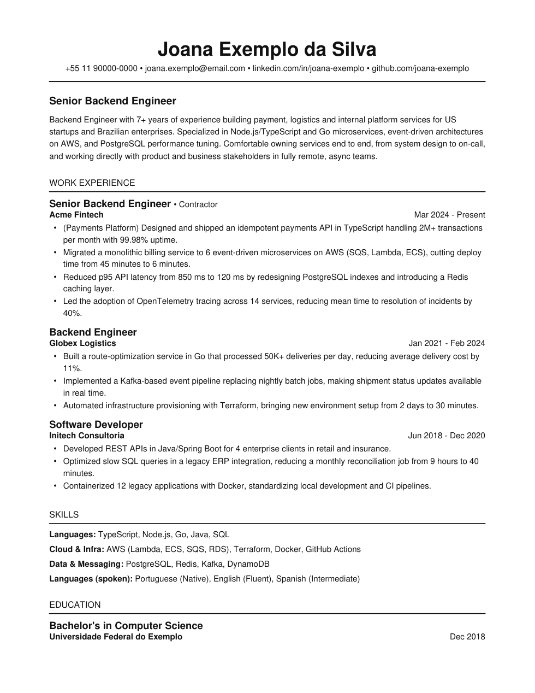
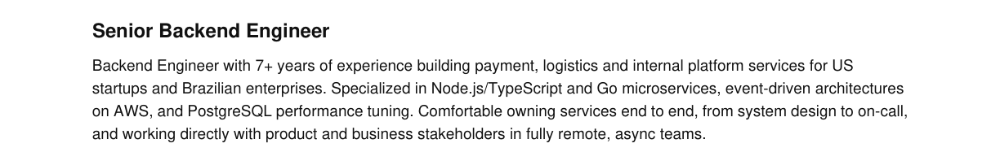
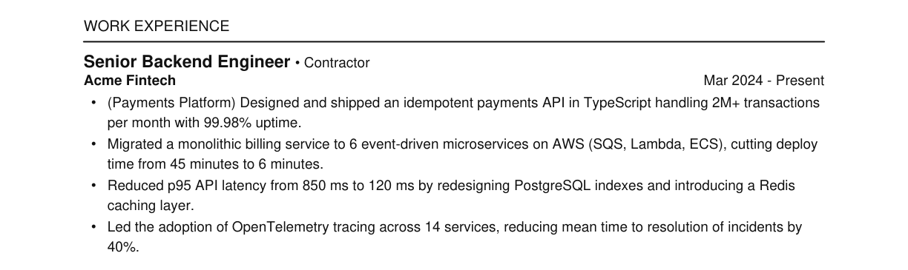
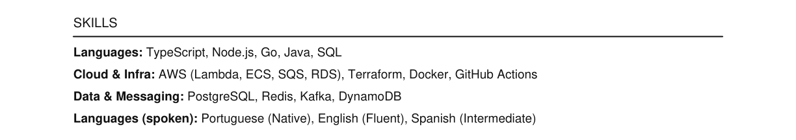

Ahora ya eres un profesional que domina su stack y habla inglés. Hora de empezar a venderte. Yo entiendo "venderte" como los próximos 4 temas, que son:

1. **Armar tu currículum:** es lo que te abre las puertas de los procesos de selección. Tiene que resaltar tus fortalezas y pasar el ATS, nada más.
2. **LinkedIn:** es otra puerta a los procesos de selección. Lo más importante es configurar tu perfil y hacer conexiones. Participar activamente en la red social es secundario, pero igual tiene su relevancia.
3. **Buscar vacantes:** buscar vacantes también es saber venderte, es igualito a ser vendedor de puerta en puerta, solo que eres tú el que llena los mismos datos 3000 veces.
4. **Entrevista:** es la cumbre de todo lo que hicimos hasta aquí, así que llega preparado.

Aquí nos vamos a enfocar solo en el currículum.

## Diseño: no hay

Olvídate de todos esos currículums con colores, foto, elementos visuales, etc. El currículum para tech es **solo contenido**, y tiene que pasar el ATS (*Applicant Tracking System*, el robot que lee tu currículum antes que cualquier humano).

Yo usaba resumake.io, que era solo una interfaz que compilaba el currículum en LaTeX con unos diseños predefinidos. Hoy recomiendo escribirlo en **Markdown** y generar el PDF a partir de ahí. Al ATS le da igual si viene de LaTeX, Markdown o Word: lo que importa es que el PDF final tenga **texto de verdad** (que lo puedas seleccionar y copiar), **una sola columna** y una fuente estándar. Markdown simplemente es mucho más fácil de editar, y la Skill de más abajo te genera el PDF.

Así queda (todo inventado, obvio, Joana no existe):

Ahora vamos por partes.

## Estructura

### Encabezado

Nombre, número de teléfono (con el código de tu país, tipo +52, +57, +54), e-mail y portafolio/GitHub si tienes. Nada más. Sin dirección, sin estado civil, sin foto, sin fecha de nacimiento, nada.

### Título y resumen

El título es tu puesto. En el caso del mío actual, uso *Analytics Engineer*. Después, un breve resumen profesional de lo que haces, dos o tres líneas.

### Experiencia

Separada por empresa, siempre con tu **último título** dentro de esa empresa. Pon también el periodo que estuviste.

Cada herramienta que quieras resaltar debe tener su propio bullet point, y si se puede, una **métrica** amarrada a ese bullet point. **AUNQUE NO LA HAYAS MEDIDO, SÁCATELA DE LA MANGA (O DEL CULO), PERO PON UNA MÉTRICA.**

Por ejemplo:

> Built a Power BI report on customer churn that helped the board make decisions that reduced churn by 12%.

"Ay, pero la dirección solo quería ver el número." Pues es su problema. En tu currículum fueron competentes, actuaron y mejoraron el número, sí.

Otro ejemplo:

> Optimized a data pipeline from 67 minutes to 5 minutes of runtime, cutting cloud processing costs from $420 to $10 per run.

Este segundo es mucho más fácil de medir, pero también vale la pena exagerarle un poco, solo que una **exagerada consciente**.

### Skills

Después de las experiencias, pon tus skills separadas por temas (lenguajes, herramientas, cloud, etc.). Nada de soft skills, tipo liderazgo, proactividad, etc. Esas babosadas solo les gustan a los jefes latinos.

### Educación

Al final, tu educación. Dependiendo del peso de tu educación, puedes ponerla antes. Si me hubiera graduado del MIT, ese dato iría justo después del resumen.

## Cómo crear el currículum

Dejé en el repositorio una **Skill de Claude** para ayudarles con esto ([carpeta `skills/curriculo-gringa`](https://github.com/kyomeii/devemdolar/tree/main/skills/curriculo-gringa)). Sigue todo lo que está en esta página: hace las preguntas correctas, convierte tus experiencias en bullet points con métrica, escribe el currículum en Markdown y te escupe el PDF listo, igualito al ejemplo de arriba. El mismo Claude te ayuda a configurarla sin broncas.

## Sobre mentir en el currículum

Mientan, pero **mientan con conciencia**. "¿Lo sé hacer? No, pero lo aprendo." Y el reclutador no tiene por qué saber que no lo sabes. Obvio necesitas tener una base para no decir pendejadas, pasar al reclutador de RH, y tener tiempo suficiente para profundizar y pasar la entrevista técnica también.

¿Ya hice algún proyecto profesional con dbt? Todavía no, pero hice algunos personales, y ya sé bastante. En mi currículum hay una ficción de que agarré y optimicé la capa de transformación usando dbt. Hoy domino la herramienta, y sé lo suficiente sobre esa capa de transformación específica como para entender cómo encajaría la herramienta en el proceso. Eso es mentir con conciencia.

No cuentes solo tu historia, cuenta también la historia de lo que quieres llegar a ser.
